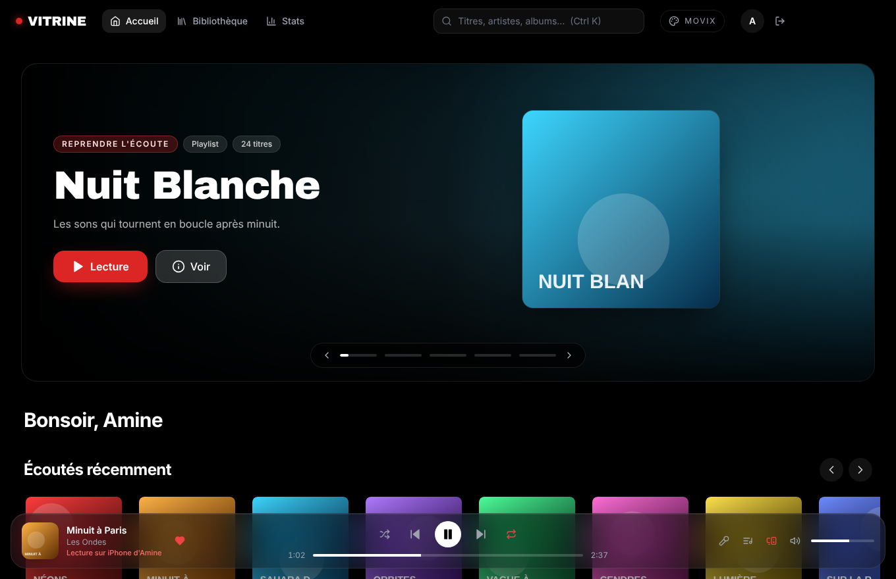
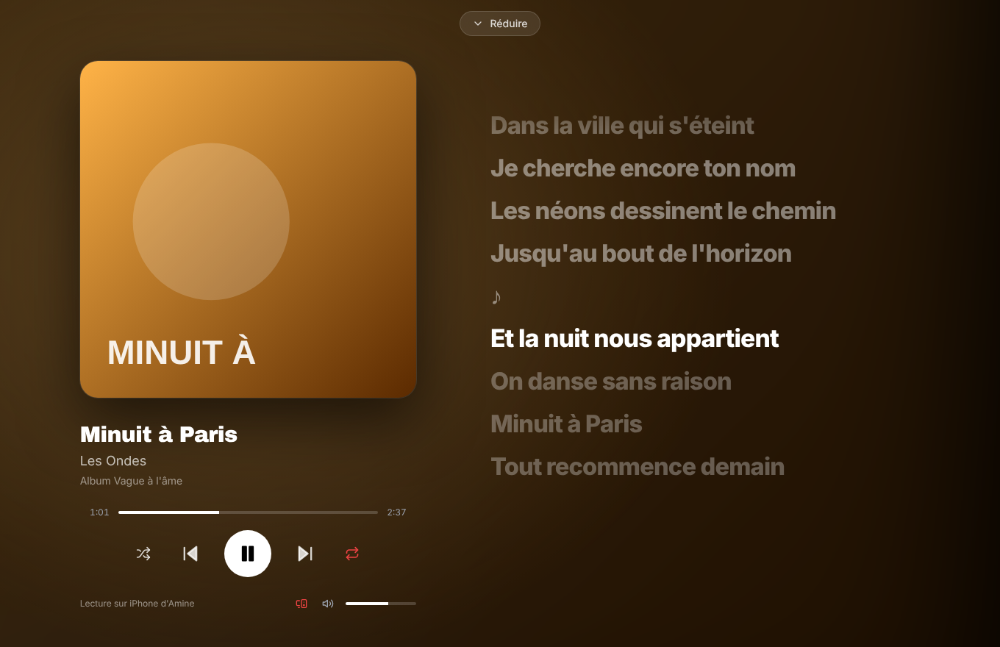
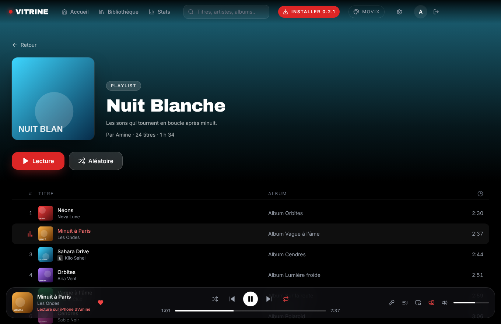
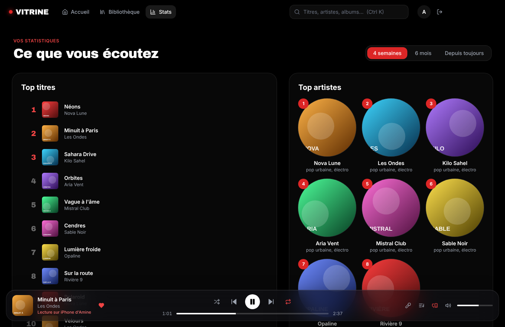
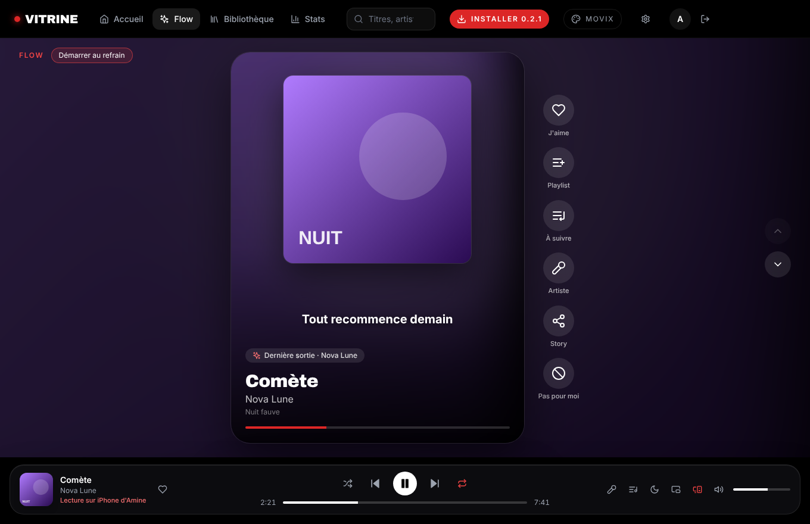
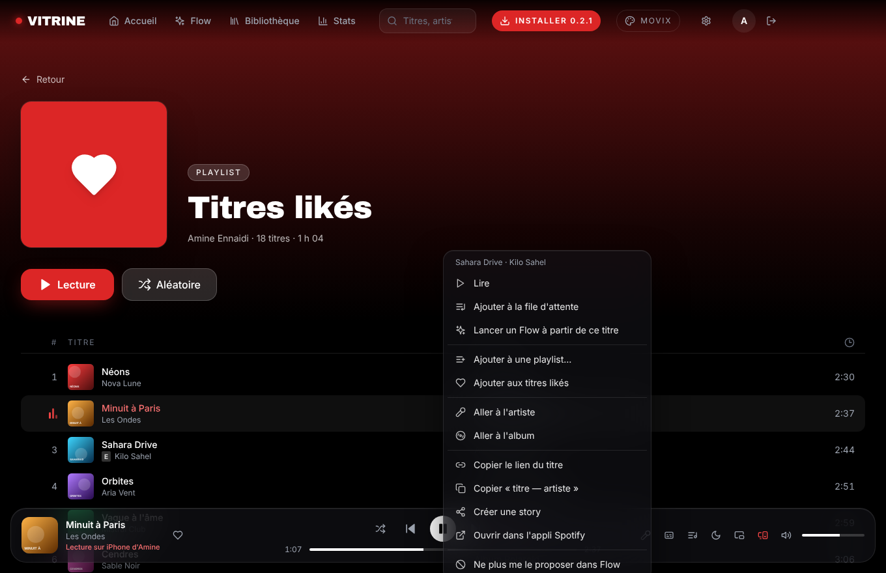
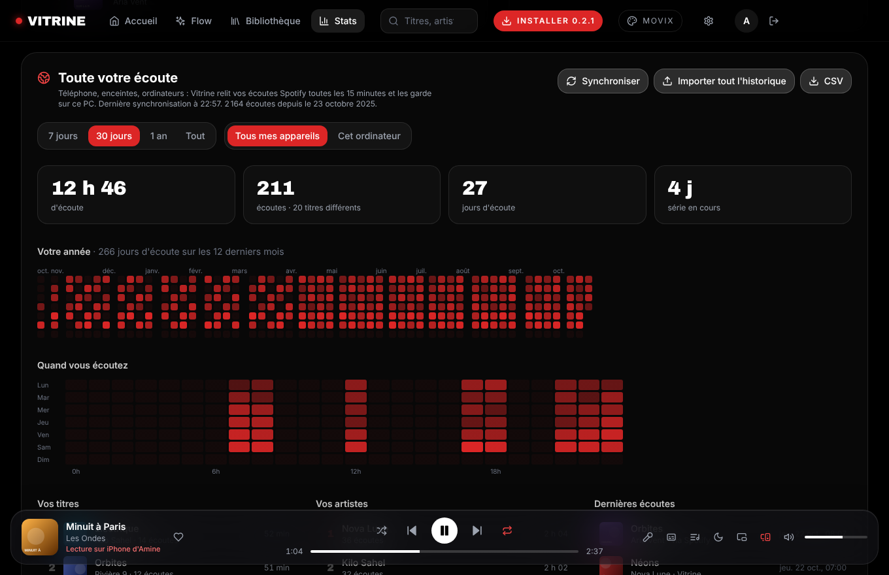
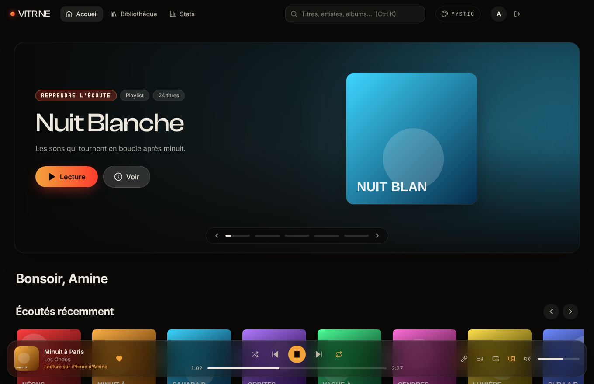
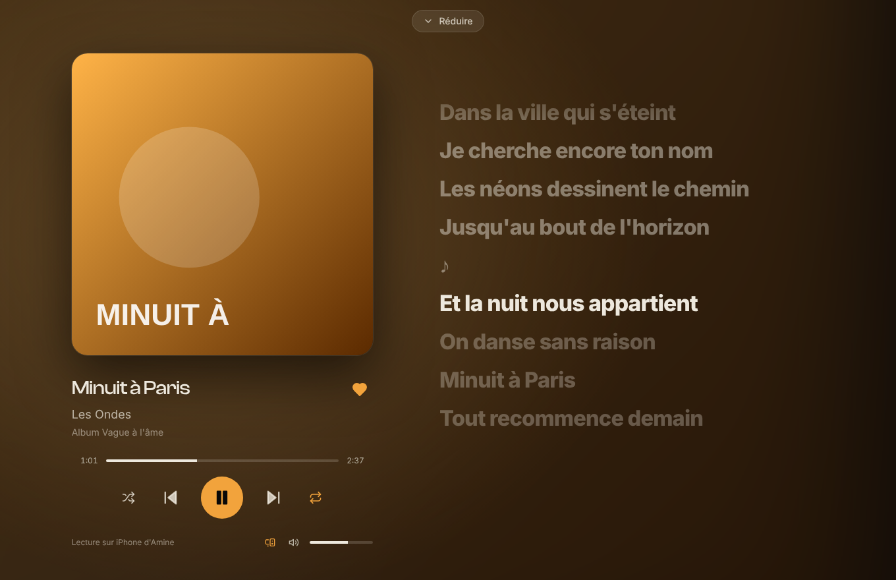

# Vitrine PC

**Lecteur Spotify de bureau pour Windows et macOS**, au design immersif : fond noir, accent
rouge, grand bandeau défilant et rangées de cartes (le style de Movix / mysticsaba), lecteur
plein écran en verre avec paroles synchronisées (l'esprit de Vitrine sur iOS).

Vitrine PC n'utilise que les **interfaces officielles de Spotify** (Web API et Web Playback SDK).
Elle ne modifie pas l'application Spotify et ne contourne ni la publicité ni l'abonnement.

<p align="center">
  
  
  
  
</p>

Objectifs, liste des fonctionnalités et feuille de route : **[ROADMAP.md](ROADMAP.md)**.

### Flow : la découverte façon TikTok

Un titre par écran, qui démarre au refrain ; la molette, les flèches ou un glissé passent au suivant.
Double-clic pour liker (avec le cœur), sous-titres tirés des paroles synchronisées, et à droite : playlist,
file d'attente, artiste, story à partager, « Pas pour moi ». Le fil mélange les nouveautés de vos artistes,
des titres autour d'eux et des pépites oubliées de vos titres likés, sans l'API de recommandation que Spotify
a fermée aux nouvelles applis.

Flow apprend de vos gestes (j'aime, sauts, « pas pour moi »), peut partir de n'importe quel titre (clic droit),
et peut ranger vos coups de cœur dans une playlist « Trouvé dans Flow ».

<p align="center">
  
  
</p>

### Toute votre écoute, pas seulement sur le PC

La page Stats suit **tous vos appareils** : Vitrine relit vos écoutes Spotify toutes les 15 minutes (téléphone,
enceintes, autres ordinateurs) et les garde sur le PC. Calendrier de l'année, carte des heures d'écoute, séries de
jours, vos titres et artistes, export CSV. Pour remonter jusqu'à la création du compte, demandez à Spotify votre
« historique de streaming étendu » et importez le ZIP tel quel (inspiré de Swiftify et stats.fm).

<p align="center">
  
</p>

### Et aussi

- **Clic droit sur un titre**, comme dans Spotify : file d'attente, playlist, j'aime, artiste, album, lien,
  story, Flow à partir de ce titre, corbeille…
- **Paroles sur le bureau** (d'après Liner) : la ligne chantée par-dessus toutes les applis (Ctrl+Alt+K).
- **Corbeille** et **mélange parfait** (d'après Trashbin et Shuffle+ de Spicetify).
- **Story** 1080 × 1920 pour TikTok, Instagram ou Snapchat, avec la ligne de paroles du moment.
- **Raccourcis globaux** : Ctrl+Alt+Espace (lecture/pause), Ctrl+Alt+→ / ←, Ctrl+Alt+L (liker), Ctrl+Alt+F (Flow),
  Ctrl+Alt+K (paroles), et en ligne de commande : `Vitrine.exe --next`, `--play-pause`, `--like`, `--flow`, `--lyrics`.

<p align="center">
  
</p>

### Deux thèmes

Un bouton dans l'en-tête bascule entre **Movix** (noir et rouge) et **Mystic**, d'après
[mysticsaba.com](https://mysticsaba.com) : noir chaud, crème, dégradé ambre → rouge, polices Clash Display,
Satoshi et JetBrains Mono. Les polices Clash Display et Satoshi viennent de [Fontshare](https://www.fontshare.com)
et sont chargées depuis leurs serveurs (licence ITF Free Font License, à vérifier avant toute diffusion) ;
hors ligne, Archivo Black et Inter les remplacent.

<p align="center">
  
  
</p>

## Ce qu'il faut

- **Spotify Premium** pour écouter sur l'ordinateur (sinon Vitrine pilote un autre appareil : téléphone, enceinte, appli officielle).
- Un **Client ID Spotify** (gratuit) :
  1. Créez une application sur le [tableau de bord développeur Spotify](https://developer.spotify.com/dashboard).
  2. Ajoutez l'URI de redirection `http://127.0.0.1:8898/callback`.
  3. Cochez **Web API** et **Web Playback SDK**.
  4. Collez le Client ID dans Vitrine au premier lancement (ou intégrez-le à la compilation, voir plus bas).

En mode développement, Spotify limite l'application aux comptes que vous ajoutez dans
*User Management* du tableau de bord.

## Installer

Les installateurs sont produits par GitHub Actions à chaque envoi sur `main`
(onglet **Actions** → dernière exécution **Build** → artefacts `vitrine-win` et `vitrine-mac`).
Mise en place pas à pas, secrets et coûts : **[docs/GITHUB.md](docs/GITHUB.md)**.

- **Windows** : `Vitrine-Setup-x.y.z.exe`. Sans certificat de signature, Windows SmartScreen affiche
  un avertissement : *Informations complémentaires → Exécuter quand même*.
- **macOS** : `Vitrine-x.y.z-arm64.dmg` (Apple Silicon) ou `-x64.dmg` (Intel). L'application n'est
  pas notarisée : au premier lancement, *Réglages Système → Confidentialité et sécurité → Ouvrir quand même*.

## Développer

```bash
npm install
npm run dev        # Vite + Electron avec rechargement à chaud
npm test           # tests unitaires (Vitest)
npm run build      # vérification TypeScript + compilation
npm run dist:win   # installateur Windows (sur Windows)
npm run dist:mac   # images disque macOS (sur un Mac)
```

### Architecture

```
electron/            processus principal (Node)
  main.ts            fenêtre, protocole app://, Widevine, IPC filtré par origine
  auth.ts            connexion Spotify (PKCE, navigateur système), jetons chiffrés par le trousseau
  pkce.ts            fonctions pures de l'OAuth PKCE (testées)
  lyrics.ts          paroles depuis LRCLIB, côté processus principal
  browserPlayer.ts   lecture via Edge ou Chrome quand Spotify refuse le DRM d'Electron
  desktop.ts         zone de notification, barre des tâches, notifications, raccourcis globaux
  history.ts         historique d'écoute de tout le compte (JSONL) : synchro, import de l'export Spotify, CSV
  overlay.ts         paroles sur le bureau (fenêtre transparente au premier plan)
  zip.ts             lecture de l'archive de données envoyée par Spotify
  cli.ts             commandes en ligne (--next, --flow…) passées à l'instance ouverte
  preload.ts         le seul pont vers la page (contextBridge)
src/renderer/        interface (React 18, Tailwind CSS, framer-motion, lucide-react, Embla)
  lib/spotify.ts     Web API officielle
  lib/flow.ts        le fil de Flow (nouveautés, autour de vos artistes, pépites oubliées)
  lib/flowTaste.ts   ce que Flow apprend de vos gestes
  lib/story.ts       la story 1080 × 1920 du titre en cours
  lib/trash.ts       la corbeille (titres et artistes sautés partout)
  player/engine.ts   lecture : SDK local (cet ordinateur) ou télécommande Spotify Connect
  player/history.ts  ce qui compte comme une écoute (30 s, ou la moitié d'un titre court)
  components/        en-tête, bandeau, cartes, rangées, lecteur, paroles, appareils
  views/             connexion, accueil, Flow, recherche, bibliothèque, statistiques, playlist/album
tests/               tests unitaires
```

La pile front reprend celle de Movix : React, Vite, TypeScript, Tailwind CSS 3, framer-motion,
lucide-react, Embla Carousel, polices Inter et Archivo Black.

### Lecture sur l'ordinateur : Widevine

Le Web Playback SDK de Spotify exige le DRM **Widevine**, absent d'Electron standard. Vitrine utilise
donc **Electron for Content Security** de castlabs (`castlabs/electron-releases`, version `+wvcus`).

Pour une lecture fiable en production, l'application doit aussi être **signée VMP** par castlabs :
créez un compte gratuit [castlabs EVS](https://github.com/castlabs/electron-releases/wiki/EVS), puis
ajoutez les secrets `EVS_ACCOUNT_NAME` et `EVS_PASSWD` au dépôt GitHub. La compilation signe alors
automatiquement (`scripts/evs-sign.cjs`). Sans Widevine, Vitrine passe en mode télécommande.

### Secrets GitHub (facultatifs)

| Secret | Effet |
|---|---|
| `VITRINE_CLIENT_ID` | Client ID intégré : les utilisateurs n'ont plus à en saisir un |
| `EVS_ACCOUNT_NAME`, `EVS_PASSWD` | Signature Widevine VMP (castlabs EVS) |

## Sécurité

- Pas de secret client : OAuth **PKCE**, le navigateur du système revient sur `127.0.0.1:8898`.
- Le jeton de rafraîchissement est **chiffré** (Trousseau macOS, DPAPI Windows) et ne quitte
  jamais le processus principal ; la page ne reçoit que des jetons d'accès d'une heure.
- La page est isolée (`contextIsolation`, `sandbox`, pas de Node) ; chaque appel IPC vérifie son
  origine ; une Content-Security-Policy limite les scripts à l'application et au SDK Spotify.

## Crédits

Inspiré de [Vitrine](https://github.com/Clone5030/vitrine) (Spotify en Liquid Glass sur iOS) et du
style de [Movix](https://github.com/movixstream/MovixOpenSource) par mysticsaba. Aucun code n'en est
copié. Paroles : [LRCLIB](https://lrclib.net). Spotify est une marque de Spotify AB ; ce projet n'est
pas affilié à Spotify.
