# Vitrine PC

**Lecteur Spotify de bureau pour Windows, macOS et Linux**, en français et en anglais, au design immersif : fond noir, accent
rouge, grand bandeau défilant et rangées de cartes (le style de Movix / mysticsaba), lecteur
plein écran en verre avec paroles synchronisées (l'esprit de Vitrine sur iOS).

Vitrine PC n'utilise que les **interfaces officielles de Spotify** (Web API et Web Playback SDK).
Elle ne modifie pas l'application Spotify et ne contourne ni la publicité ni l'abonnement.

<p align="center">
  
  
  
  
</p>

Objectifs, liste des fonctionnalités et feuille de route : **[ROADMAP.md](ROADMAP.md)**.

### Vitrine 1.0 — prête pour tout le monde (v1.0.0)

La liste cochée : **[PLAN-V0.9-V1.0.md](docs/PLAN-V0.9-V1.0.md)**.

- **English version** : Réglages › Langue · Language (Auto suit le système). Toute l'interface, les menus de la zone
  de notification, les boîtes de dialogue et les images à partager ; les titres, les artistes et les paroles ne sont
  jamais traduits.
- **Accessibilité** : tout au clavier, avec un contour visible ; « Aller au contenu » au premier Tab ; le titre qui
  commence est annoncé aux lecteurs d'écran ; contrastes WCAG AA vérifiés automatiquement (axe) à chaque envoi.
- **Raccourcis personnalisables** : « ? » liste toutes les actions et les raccourcis globaux, chacun se change
  (nouveaux : titre suivant/précédent, paroles plein écran, liker).
- **Rapport d'erreur sur consentement** : les erreurs restent sur l'ordinateur, sans jeton ni nom d'utilisateur ;
  Réglages › Rapport d'erreur pour les copier ou ouvrir un ticket GitHub. Une page cassée affiche un écran de secours.
- **Accueil du premier lancement** en trois écrans, thème et langue choisis tout de suite.
- **Linux** : AppImage, avec mise à jour automatique et lancement au démarrage.
- **Règles Spotify de 2026** : Vitrine fonctionne avec les applications Spotify créées depuis février 2026 (likes,
  playlists des autres jouées en entier, quota épuisé respecté). Ce que cela change pour vous : *Ce qu'il faut*, plus bas.
- Mesures : **[MESURES-V1.0.md](docs/MESURES-V1.0.md)** · dossier Spotify : **[SPOTIFY-QUOTA-ETENDU.md](docs/SPOTIFY-QUOTA-ETENDU.md)**
  · publier une version : **[LIVRAISON.md](docs/LIVRAISON.md)**

<p align="center">
  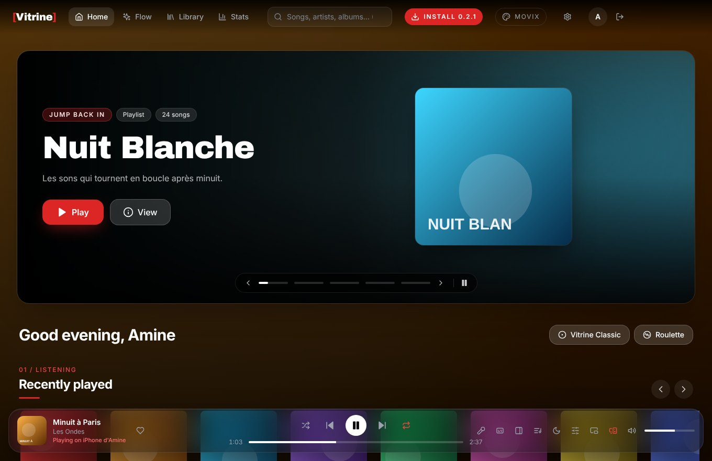
  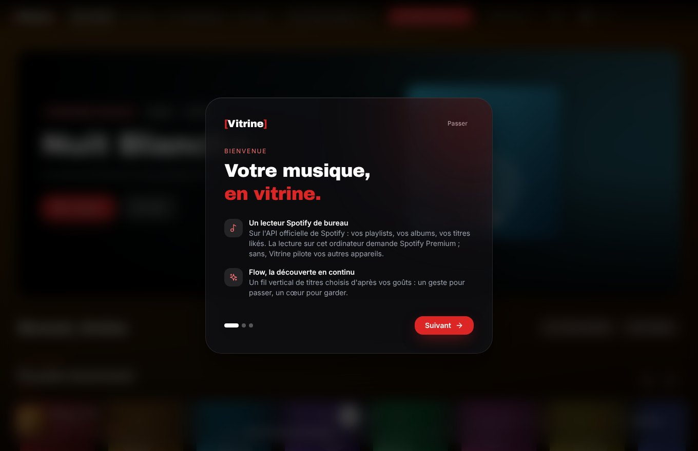
  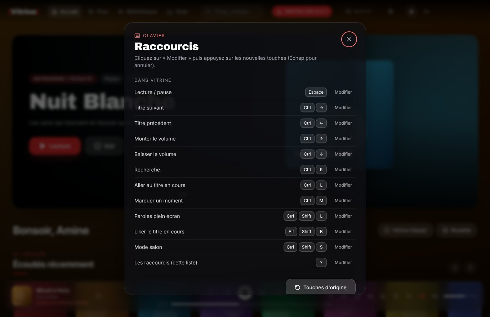
  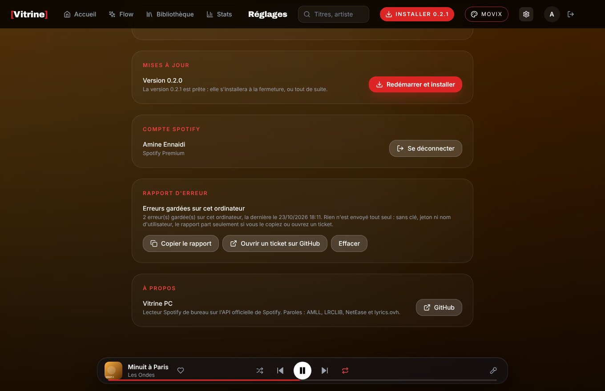
</p>

### Le lecteur, la découverte, les connexions (v0.9.0)

La liste cochée : **[PLAN-V0.9-V1.0.md](docs/PLAN-V0.9-V1.0.md)**.

- **Feats** (v0.8.2) : chaque artiste de son côté, son nom quand la voix change, les voix ensemble au centre, les
  couplets d'un posse cut en alternance (les en-têtes de Genius alignés sur les paroles synchronisées). **Paroles
  fluides** : la lumière des mots peinte à chaque image, fonds floutés une seule fois au lieu de l'être à chaque image.
- **Le lecteur** : la pochette de la barre grandit jusqu'au plein écran ; la barre se replie quand on fait défiler ;
  thème **Verre** (Liquid Glass) ; **mode salon** (Ctrl+Maj+S) pour une télé ou un deuxième écran, lisible de loin.
- **Traduction des paroles** sous chaque ligne (MyMemory sans clé, ou DeepL avec la vôtre).
- **Sorties de vos artistes**, **import de playlists** (CSV d'Exportify, TuneMyMusic, Excel, ou liste « Artiste -
  Titre »), **crédits** de chaque titre (MusicBrainz), **file infinie** quand une liste se termine.
- **Last.fm** (avec votre clé) et **Rétro Vitrine en vidéo** verticale de 15 s.
- **Intégration continue** : types, tests, et un essai de bout en bout de la page à chaque envoi sur GitHub.

<p align="center">
  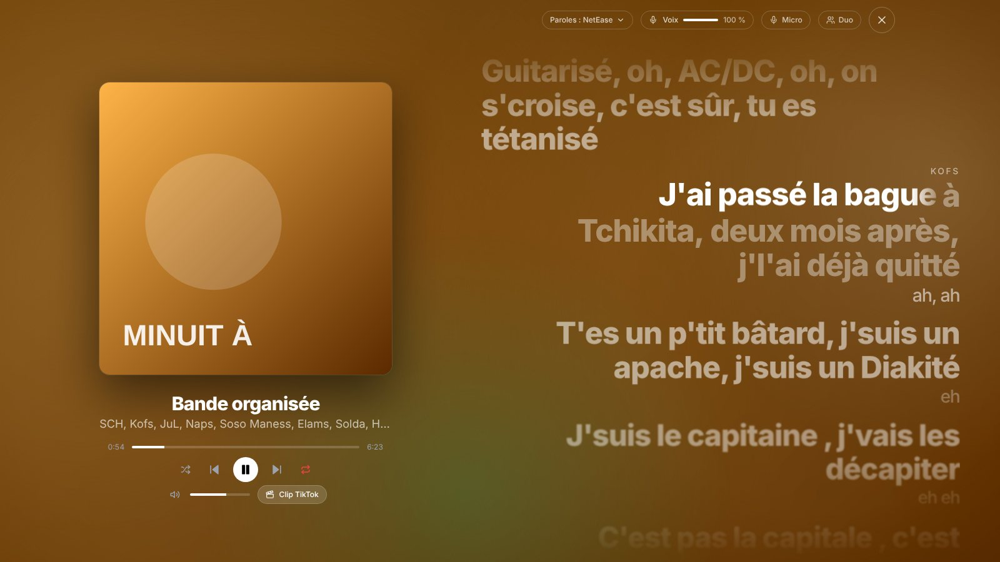
  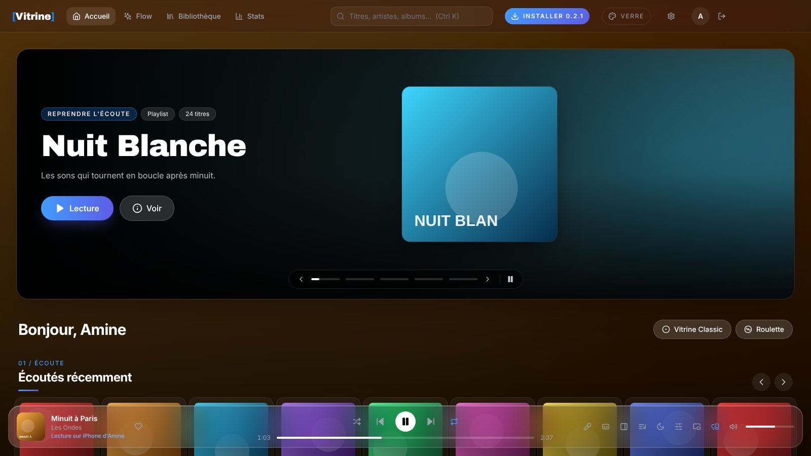
  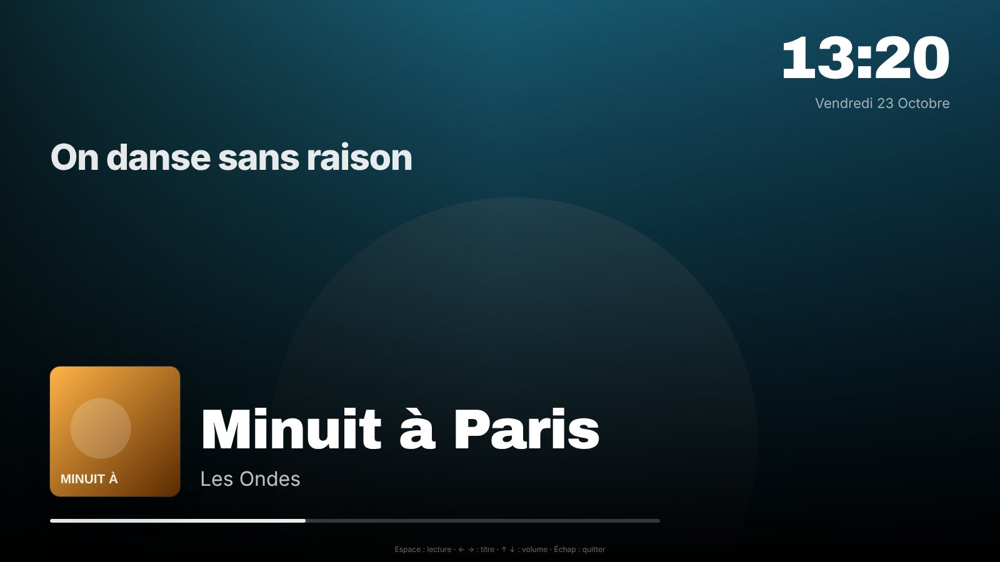
  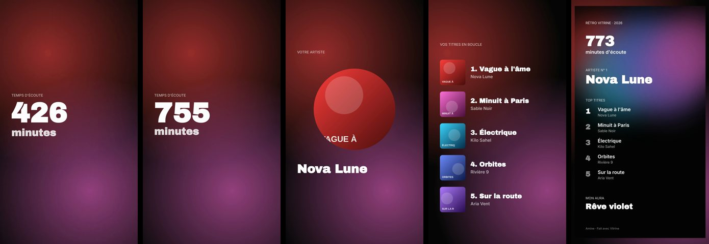
</p>

### Le deuxième écran, les paroles de partout, le karaoké d'Apple Music (v0.8.1)

La liste cochée : **[PLAN-V0.8.1.md](docs/PLAN-V0.8.1.md)**, avec ce qui vient des thèmes Spicetify, d'AMLL, de
Spicy Lyrics, d'Apple Music Sing et de TikTok.

- **Sur un écran vertical** (ou très large), le panneau **« À l'écoute »** s'ouvre à droite : la pochette et le titre,
  les **paroles en direct** dans une carte aux couleurs de la pochette, la suite, **vos écoutes** de ce titre (combien,
  depuis quand), **vos moments**, l'artiste, et les boutons Versions, Story, Clip TikTok. L'en-tête se resserre.
- **Ambiance** : la pochette en cours, floutée, en fond de toute l'appli, sous des panneaux en verre (comme les thèmes
  Hazy et Glowify de Spicetify). Réglable, masquée en mode léger.
- **Paroles de quatre sources** : **AMLL TTML DB** (mot à mot, duos, chœurs), **LRCLIB**, **NetEase** (beaucoup de rap
  français ; pas une API officielle, désactivable) et **lyrics.ovh**. La meilleure d'abord ; « Paroles : … » change de
  source ou **décale la synchro** pour un titre ; « Ce ne sont pas les bonnes paroles ». Gardées sur l'ordinateur.
- **Écran des paroles façon Apple Music** : pochette, titre et barre à gauche, paroles à droite (empilé en vertical),
  lignes qui arrivent **en vague**, **mots tenus qui brillent**, **duo** (le deuxième chanteur à droite), chœurs qui se
  remplissent aussi, paroles non synchronisées qui défilent avec la chanson.
- **Karaoké façon Apple Music Sing** : curseur **Voix** (originale ou instrumentale officielle, au même instant), le
  **micro de l'ordinateur** avec réverbération (studio, salle, stade) ou écho et vumètre, mode **Duo** chacun son tour.
- **Clip TikTok** : 15 s des paroles en vidéo verticale (1080 × 1920), mot à mot, à poster avec le son ajouté dans TikTok.
- Corrigé : les boutons du haut à droite passaient sous ceux de la fenêtre ; un fin trait blanc apparaissait sur le mot
  suivant.

<p align="center">
  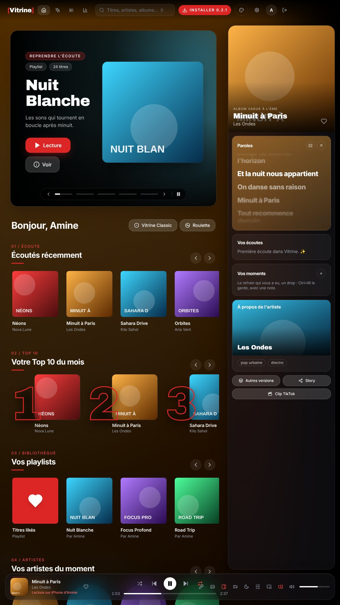
  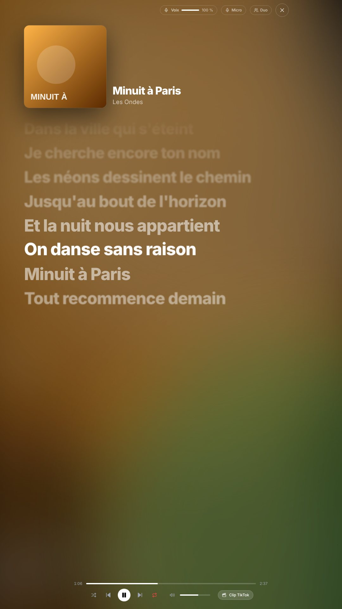
  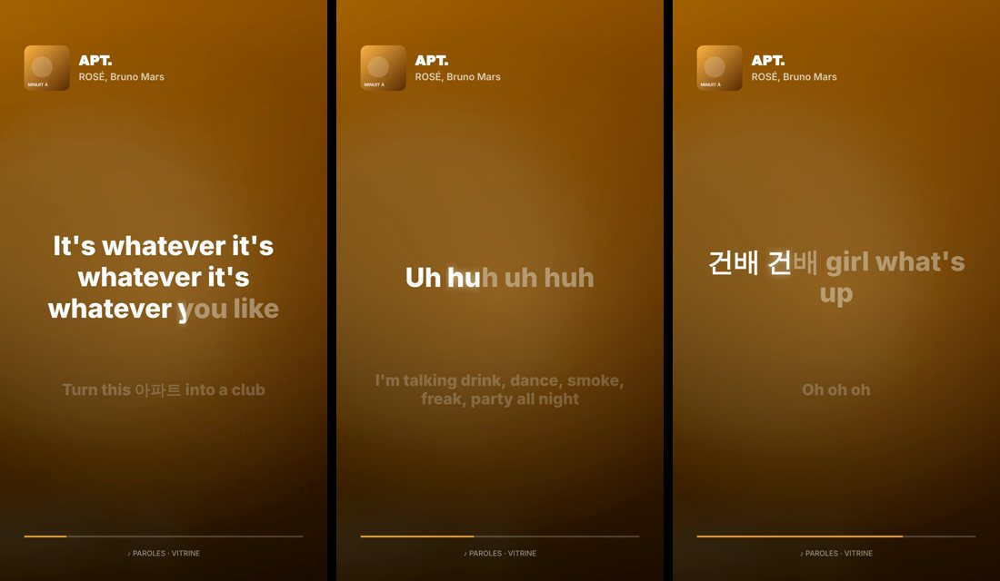
  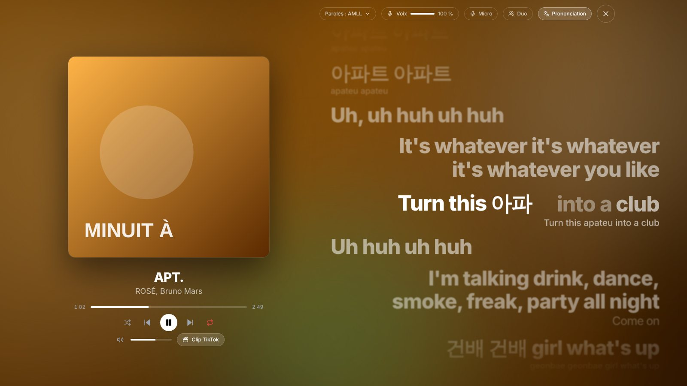
  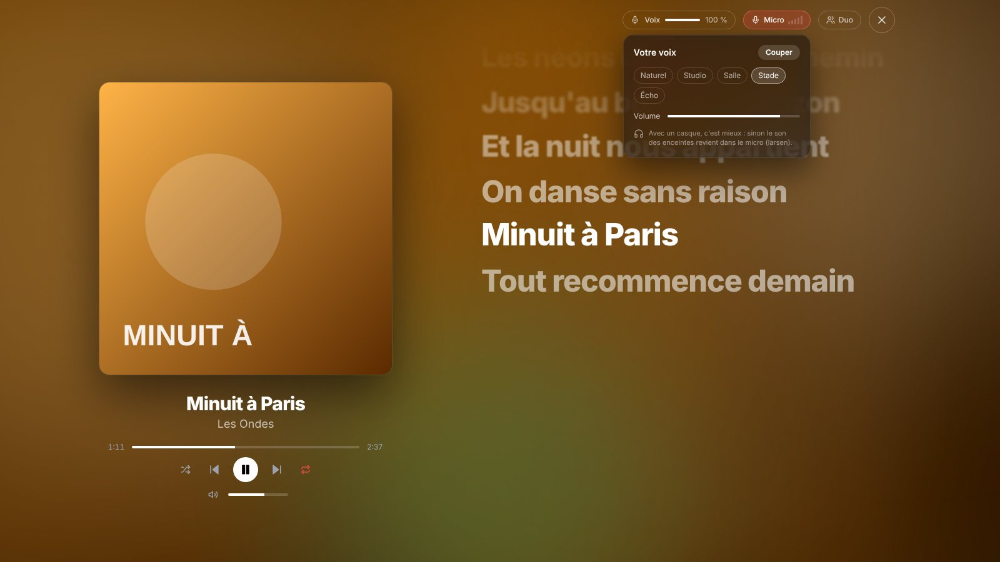
</p>

Captures sur données fictives (le compte Spotify était en pause) ; les paroles d'« APT. » sont les vraies, venues
d'AMLL TTML DB.

### Apple Music, TikTok, et bien plus (v0.8.0)

Tout vient de trois études : **[Apple Music](docs/INSPIRATION-APPLE-MUSIC.md)**, **[TikTok et les projets
voisins](docs/INSPIRATION-TIKTOK-PROJETS.md)**, et la liste cochée de ce qui est fait : **[PLAN-V0.8.md](docs/PLAN-V0.8.md)**.

- **Paroles façon Apple Music** : mot par mot, points pendant les silences, chœurs plus petits, flou selon la distance,
  défilement libre, et la **prononciation** en lettres latines sous le coréen, le japonais (kana), le russe, le grec.
- **Karaoké sans la voix**, dans les règles de Spotify : la **version instrumentale officielle** joue au même instant,
  avec les paroles de l'original. **Autres versions** d'un titre : accélérée, ralentie (la tendance TikTok),
  acoustique, live, remix.
- **Égaliseur** 10 bandes et préréglages, appliqué à la sortie son de Windows par Equalizer APO (gratuit).
- **Lecteur** : pochette qui recule à la pause, fond vivant, **mode vinyle**, **boucle A–B** et refrain en boucle,
  « Ensuite » 10 s avant la fin, titre qui défile, balayer la barre pour changer de titre, temps restant.
- **Rétro Vitrine** (votre mois ou votre année en diapositives) et les images qu'on partage sur TikTok : **reçu**,
  **affiche de festival**, **iceberg** de vos artistes, **aura musicale**.
- **Bibliothèque** : épingles (aussi dans la barre des tâches Windows), accès rapide, « Ce moment », ajoutés récemment,
  tri, colonnes **Lectures** et **Dernière écoute**, playlists intelligentes, pages d'album et d'artiste refaites,
  recherche dans votre bibliothèque, **Moments** (instants marqués avec une note).
- **Vitrine Classic** : le look des baladeurs des années 2000, avec une molette qui tourne.

<p align="center">
  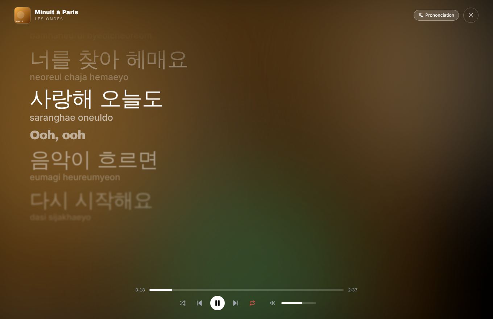
  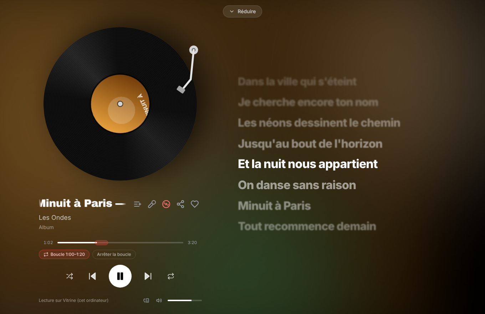
  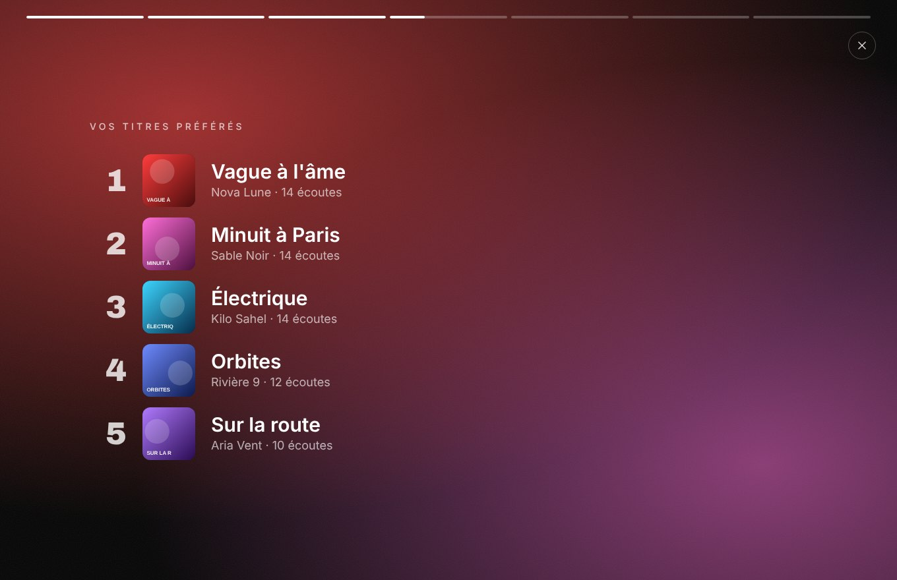
  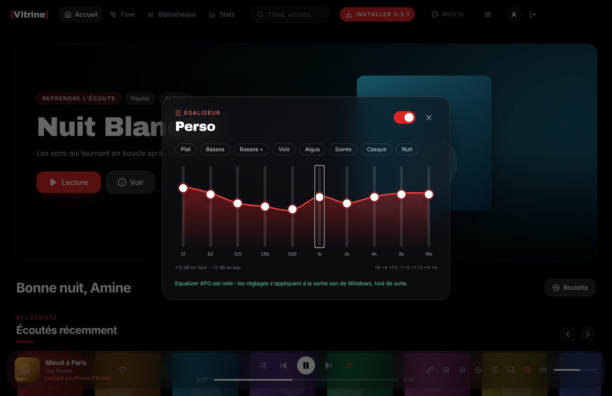
  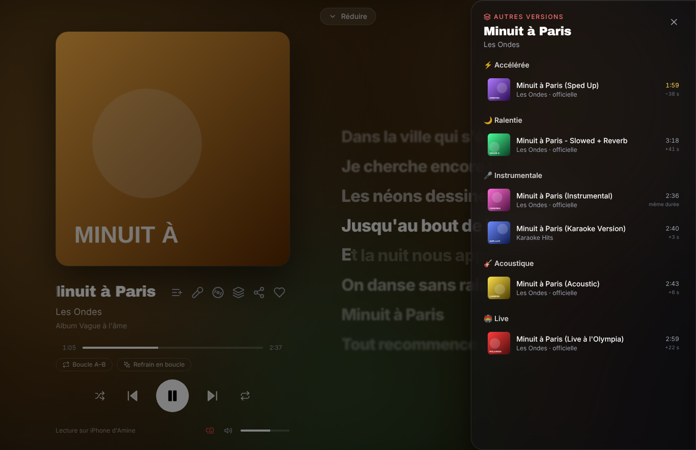
  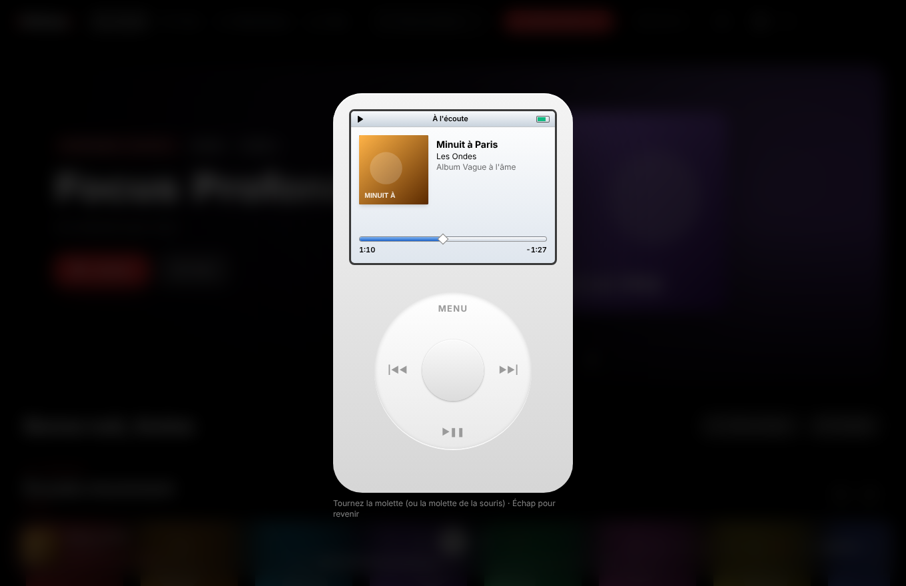
</p>

**Plus sobre avec Spotify** : la limite de requêtes est respectée partie par partie (v0.7.2), et rien de ce qui
précède n'ajoute de demandes régulières : tout ce qui peut venir de l'historique local en vient.

### Dans l'esprit Movix et Musix (v0.7.0)

Logo **[Vitrine]** de la famille [ix], **Top 10 du mois** aux chiffres géants, titres de section numérotés, **paroles
karaoké** plein écran qui se remplissent au fil du chant sur un fond aux couleurs de la pochette, **roulette** de vos
playlists, écran de veille. L'étude complète de mysticsaba.com, movix.dog et MovixOpenSource (ce qu'ils feraient,
comment, pour et contre, pièges) : **[docs/INSPIRATION-MOVIX-MYSTIC.md](docs/INSPIRATION-MOVIX-MYSTIC.md)**.

<p align="center">
  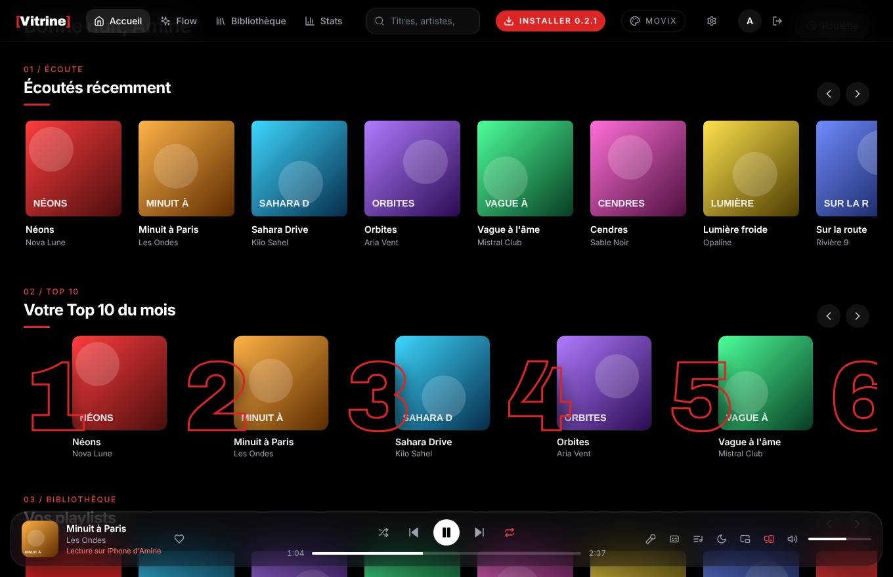
  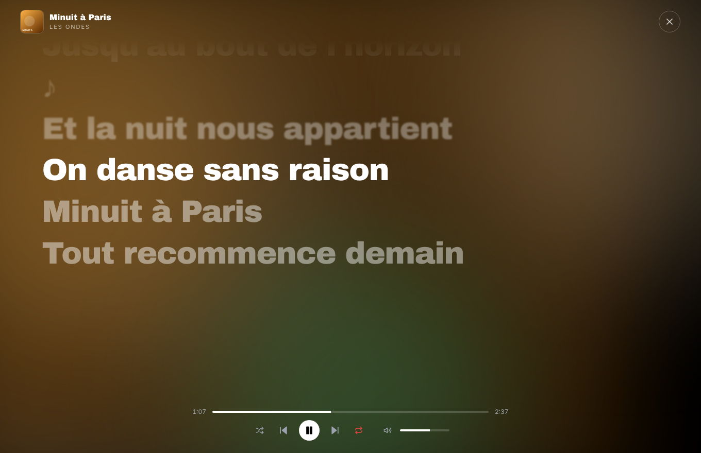
</p>

**Plus léger** : mode léger automatique sur un PC modeste (comme Movix), page libérée quand Vitrine est réduite dans
la zone de notification (la musique continue), images à la bonne taille. Mesuré : −26 % en plein écran, −39 % quand
Vitrine est cachée.

### Flow : la découverte façon TikTok

Un titre par écran, qui démarre au refrain ; la molette, les flèches ou un glissé passent au suivant.
Double-clic pour liker (avec le cœur), sous-titres tirés des paroles synchronisées, et à droite : playlist,
file d'attente, artiste, story à partager, « Pas pour moi ». Le fil mélange les nouveautés de vos artistes,
des titres autour d'eux et des pépites oubliées de vos titres likés, sans l'API de recommandation que Spotify
a fermée aux nouvelles applis.

Flow apprend de vos gestes (j'aime, sauts, « pas pour moi »), peut partir de n'importe quel titre (clic droit),
et peut ranger vos coups de cœur dans une playlist « Trouvé dans Flow ».

<p align="center">
  
  
</p>

### Toute votre écoute, pas seulement sur le PC

La page Stats suit **tous vos appareils** : Vitrine relit vos écoutes Spotify toutes les 15 minutes (téléphone,
enceintes, autres ordinateurs) et les garde sur le PC. Calendrier de l'année, carte des heures d'écoute, séries de
jours, vos titres et artistes, export CSV. Pour remonter jusqu'à la création du compte, demandez à Spotify votre
« historique de streaming étendu » et importez le ZIP tel quel (inspiré de Swiftify et stats.fm).

<p align="center">
  
</p>

### Et aussi

- **Clic droit sur un titre**, comme dans Spotify : file d'attente, playlist, j'aime, artiste, album, lien,
  story, Flow à partir de ce titre, corbeille…
- **Paroles sur le bureau** (d'après Liner) : la ligne chantée par-dessus toutes les applis (Ctrl+Alt+K).
- **Corbeille** et **mélange parfait** (d'après Trashbin et Shuffle+ de Spicetify).
- **Story** 1080 × 1920 pour TikTok, Instagram ou Snapchat, avec la ligne de paroles du moment.
- **Raccourcis globaux** : Ctrl+Alt+Espace (lecture/pause), Ctrl+Alt+→ / ←, Ctrl+Alt+L (liker), Ctrl+Alt+F (Flow),
  Ctrl+Alt+K (paroles), et en ligne de commande : `Vitrine.exe --next`, `--play-pause`, `--like`, `--flow`, `--lyrics`.

<p align="center">
  
</p>

### Deux thèmes

Un bouton dans l'en-tête bascule entre **Movix** (noir et rouge) et **Mystic**, d'après
[mysticsaba.com](https://mysticsaba.com) : noir chaud, crème, dégradé ambre → rouge, polices Clash Display,
Satoshi et JetBrains Mono. Les polices Clash Display et Satoshi viennent de [Fontshare](https://www.fontshare.com)
et sont chargées depuis leurs serveurs (licence ITF Free Font License, à vérifier avant toute diffusion) ;
hors ligne, Archivo Black et Inter les remplacent.

<p align="center">
  
  
</p>

## Ce qu'il faut

- **Spotify Premium** pour écouter sur l'ordinateur (sinon Vitrine pilote un autre appareil : téléphone, enceinte, appli officielle).
- Un **Client ID Spotify** (gratuit) :
  1. Créez une application sur le [tableau de bord développeur Spotify](https://developer.spotify.com/dashboard).
  2. Ajoutez l'URI de redirection `http://127.0.0.1:8898/callback`.
  3. Cochez **Web API** et **Web Playback SDK**.
  4. Collez le Client ID dans Vitrine au premier lancement (ou intégrez-le à la compilation, voir plus bas).

En mode développement, Spotify limite l'application aux comptes que vous ajoutez dans
*User Management* du tableau de bord : **cinq personnes au plus**, et depuis février 2026 **le propriétaire de
l'application doit avoir Premium**. Le plus simple : que chacun crée sa propre application (cinq minutes, l'écran
de connexion de Vitrine guide). Le « quota étendu » qui lèverait ces limites est réservé par Spotify aux
organisations établies : voir [docs/SPOTIFY-QUOTA-ETENDU.md](docs/SPOTIFY-QUOTA-ETENDU.md).

## Installer

Les installateurs sont produits par GitHub Actions à chaque envoi sur `main`
(onglet **Actions** → dernière exécution **Build** → artefacts `vitrine-win`, `vitrine-mac` et `vitrine-linux`).
Mise en place pas à pas, secrets et coûts : **[docs/GITHUB.md](docs/GITHUB.md)**.

- **Windows** : `Vitrine-Setup-x.y.z.exe`. Sans certificat de signature, Windows SmartScreen affiche
  un avertissement : *Informations complémentaires → Exécuter quand même*.
- **macOS** : `Vitrine-x.y.z-arm64.dmg` (Apple Silicon) ou `-x64.dmg` (Intel). L'application n'est
  pas notarisée : au premier lancement, *Réglages Système → Confidentialité et sécurité → Ouvrir quand même*.
- **Linux** : `Vitrine-x.y.z-x86_64.AppImage`, puis `chmod +x` et double-clic (Ubuntu 22.04 et plus : paquet
  `libfuse2`). Se met à jour seule.

## Développer

```bash
npm install
npm run dev        # Vite + Electron avec rechargement à chaud
npm test           # tests unitaires (Vitest)
npm run build      # vérification TypeScript + compilation
npm run dist:win   # installateur Windows (sur Windows)
npm run dist:mac   # images disque macOS (sur un Mac)
```

### Architecture

```
electron/            processus principal (Node)
  main.ts            fenêtre, protocole app://, Widevine, IPC filtré par origine
  auth.ts            connexion Spotify (PKCE, navigateur système), jetons chiffrés par le trousseau
  pkce.ts            fonctions pures de l'OAuth PKCE (testées)
  lyrics.ts          paroles depuis LRCLIB, côté processus principal
  browserPlayer.ts   lecture via Edge ou Chrome quand Spotify refuse le DRM d'Electron
  desktop.ts         zone de notification, barre des tâches, notifications, raccourcis globaux
  history.ts         historique d'écoute de tout le compte (JSONL) : synchro, import de l'export Spotify, CSV
  overlay.ts         paroles sur le bureau (fenêtre transparente au premier plan)
  remote.ts          commandes et titre en cours quand la page est libérée (Vitrine cachée)
  spotifyPauses.ts   la pause de Spotify (trop de requêtes), respectée aussi côté processus principal
  equalizer.ts       l'égaliseur, écrit pour Equalizer APO (sortie son de Windows)
  pins.ts            les épingles, et la liste de raccourcis de la barre des tâches Windows
  moments.ts         les Moments (instants marqués avec une note)
  zip.ts             lecture de l'archive de données envoyée par Spotify
  cli.ts             commandes en ligne (--next, --flow…) passées à l'instance ouverte
  preload.ts         le seul pont vers la page (contextBridge)
src/renderer/        interface (React 18, Tailwind CSS, framer-motion, lucide-react, Embla)
  lib/spotify.ts     Web API officielle
  lib/flow.ts        le fil de Flow (nouveautés, autour de vos artistes, pépites oubliées)
  lib/flowTaste.ts   ce que Flow apprend de vos gestes
  lib/story.ts       la story 1080 × 1920 du titre en cours
  lib/trash.ts       la corbeille (titres et artistes sautés partout)
  lib/lite.ts        le mode léger (effets coupés sur un PC modeste)
  lib/apiGate.ts     4 demandes à la fois, lectures partagées, pause de Spotify tenue partie par partie
  lib/lyricsView.ts  paroles mises en scène : mot par mot, silences, chœurs, flou par distance
  lib/romanize.ts    prononciation : coréen, kana, cyrillique, grec
  lib/insights.ts    ce que dit l'historique : lectures par titre, accès rapide, « Ce moment », iceberg, semaine, étapes
  lib/cards.ts       reçu, affiche de festival, iceberg, aura, carte Rétro Vitrine (canvas)
  lib/versions.ts    autres versions d'un titre et instrumentale pour le karaoké
  player/loop.ts     boucle A–B
  player/karaoke.ts  karaoké sans la voix (version instrumentale officielle)
  player/engine.ts   lecture : SDK local (cet ordinateur) ou télécommande Spotify Connect
  player/history.ts  ce qui compte comme une écoute (30 s, ou la moitié d'un titre court)
  components/        en-tête, bandeau, cartes, rangées, lecteur, paroles, appareils
  views/             connexion, accueil, Flow, recherche, bibliothèque, statistiques, playlist/album
tests/               tests unitaires
```

La pile front reprend celle de Movix : React, Vite, TypeScript, Tailwind CSS 3, framer-motion,
lucide-react, Embla Carousel, polices Inter et Archivo Black.

### Lecture sur l'ordinateur : Widevine

Le Web Playback SDK de Spotify exige le DRM **Widevine**, absent d'Electron standard. Vitrine utilise
donc **Electron for Content Security** de castlabs (`castlabs/electron-releases`, version `+wvcus`).

Pour une lecture fiable en production, l'application doit aussi être **signée VMP** par castlabs :
créez un compte gratuit [castlabs EVS](https://github.com/castlabs/electron-releases/wiki/EVS), puis
ajoutez les secrets `EVS_ACCOUNT_NAME` et `EVS_PASSWD` au dépôt GitHub. La compilation signe alors
automatiquement (`scripts/evs-sign.cjs`). Sans Widevine, Vitrine passe en mode télécommande.

### Secrets GitHub (facultatifs)

| Secret | Effet |
|---|---|
| `VITRINE_CLIENT_ID` | Client ID intégré : les utilisateurs n'ont plus à en saisir un |
| `EVS_ACCOUNT_NAME`, `EVS_PASSWD` | Signature Widevine VMP (castlabs EVS) |

## Sécurité

- Pas de secret client : OAuth **PKCE**, le navigateur du système revient sur `127.0.0.1:8898`.
- Le jeton de rafraîchissement est **chiffré** (Trousseau macOS, DPAPI Windows) et ne quitte
  jamais le processus principal ; la page ne reçoit que des jetons d'accès d'une heure.
- La page est isolée (`contextIsolation`, `sandbox`, pas de Node) ; chaque appel IPC vérifie son
  origine ; une Content-Security-Policy limite les scripts à l'application et au SDK Spotify.

## Crédits

Inspiré de [Vitrine](https://github.com/Clone5030/vitrine) (Spotify en Liquid Glass sur iOS) et du
style de [Movix](https://github.com/movixstream/MovixOpenSource) par mysticsaba. Aucun code n'en est
copié. Paroles : [LRCLIB](https://lrclib.net). Spotify est une marque de Spotify AB ; ce projet n'est
pas affilié à Spotify.
